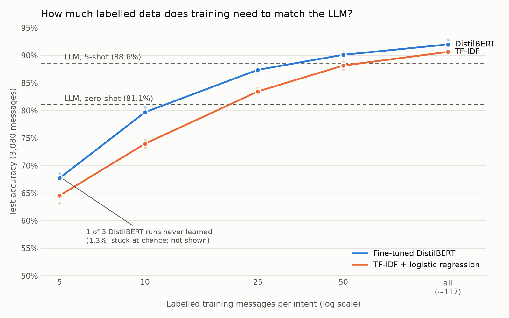

# Banking Support Intent Router

Routing bank customer messages ("my card hasn't arrived", "why was I charged a fee?") to
the right one of 77 intents, and measuring when a small fine-tuned model beats an LLM API
on accuracy, latency and cost.

## Problem

_TODO: why intent routing matters for support teams; what a wrong route costs._

## Data

[BANKING77](https://huggingface.co/datasets/PolyAI/banking77): 13,083 customer-service
queries in 77 intents, split 10,003 train / 3,080 test. A stratified validation set is
carved out of train (fixed seed) for all tuning; the test set is used only for final
numbers.

| Split | Messages | Per intent |
|---|---|---|
| train | 9,002 | 32–168 (imbalanced) |
| validation | 1,001 | 3–19 |
| test | 3,080 | 40 (balanced) |

`python src/data.py` downloads the original CSVs from
[PolyAI's GitHub](https://github.com/PolyAI-LDN/task-specific-datasets) (pinned commit,
SHA-256 checked; the Hugging Face copy no longer loads with current `datasets`) and writes
the splits to `data/`. Note: 6 test messages (0.2%) also appear word-for-word in train,
with the same label. They are kept so results stay comparable with published numbers.

## Baseline

TF-IDF + logistic regression (scikit-learn), trained on the 9,002 train messages.
Features: single words plus letter sequences of length 3–5 (catch typos such as
"witdrawal"); `class_weight="balanced"`; C=10. Chosen from a grid of 30 settings on
validation (3 feature sets × C in {0.1, 1, 10, 100, 1000} × class weights on/off), by
highest validation macro F1 (0.907), then run once on test.

On validation, letter sequences added about 1 point at every C. Word pairs did not help.
Class weights mattered only when C was small. The top 8 settings were within about 1
point (roughly 10 of 1,001 validation messages) of each other.

## Fine-tuned DistilBERT

`distilbert-base-uncased` with a new 77-intent layer, all weights trained on the 9,002
train messages (PyTorch, Apple M2 GPU, ~1.6 min per epoch). Learning rate 2e-4, batch
size 32, 5 epochs with linear decay, no class weights; the epoch with the best validation
macro F1 is kept. Every run is logged in MLflow.

Tuned one change at a time on validation (macro F1, seed 42):

| Learning rate | 2e-5 | 3e-5 | 5e-5 | 1e-4 | **2e-4** | 4e-4 |
|---|---|---|---|---|---|---|
| Val macro F1 | 0.876 | 0.911 | 0.921 | 0.921 | **0.926** | 0.901 |

Then class weights on (0.924, no gain), then seeds 43 and 44: validation F1
**0.928 ± 0.002** over 3 seeds. All three seeds were run once on test.

No sign of harmful overfitting: train accuracy reaches 99.5% while validation accuracy
stays flat and validation loss does not rise after the best epoch.

## LLM (prompted, no training)

OpenAI `gpt-5.4-mini` (snapshot `gpt-5.4-mini-2026-03-17`, the current small model;
GPT-4o-mini from the original plan is now a legacy model). The prompt is one sentence of
task plus the 77 intent names; the answer is forced to one of the 77 names (structured
output). Few-shot adds random train examples per intent (fixed seed), never test or
validation messages. Every call is cached; cost comes from the token counts the API
reports, at $0.75 / $4.50 per 1M input / output tokens.

Tried on validation (accuracy):

| Zero-shot | Zero-shot + low reasoning | 3-shot | **5-shot** |
|---|---|---|---|
| 0.787 | **0.813** | 0.861 | **0.872** |

Best zero-shot and best few-shot setup were then run once on test. The main cause of
mistakes: intent names don't say how the dataset uses them. `get_physical_card` holds
PIN questions ("How do I set up my card PIN?"), so zero-shot answers `change_pin` and
gets 0% of that intent right. Examples teach these habits; reasoning cannot.

## Results

All numbers on the full BANKING77 test set (3,080 queries). DistilBERT: mean ± standard
deviation over 3 seeds. Latency: one message at a time, Apple M2 laptop (LLM: API round
trip, median of 100).

| Approach | Accuracy | Macro F1 | Wrong (of 3,080) | Latency / query | Cost / 1k queries |
|---|---|---|---|---|---|
| TF-IDF + logistic regression | 90.6% | 0.906 | 289 | 0.53 ms (CPU) | no fee; ~6.8M msgs/hour on 1 CPU core |
| Fine-tuned DistilBERT | **92.1% ± 0.5** | **0.921 ± 0.005** | **242** (224–256) | 7.6 ms (GPU), 18 ms (CPU) | no fee; ~200k msgs/hour on 1 CPU core |
| gpt-5.4-mini, zero-shot (low reasoning) | 81.1% | 0.803 | 582 | 1,231 ms | $0.88 |
| gpt-5.4-mini, 5-shot | 88.6% | 0.885 | 350 | 1,148 ms | $0.66 ($4.70 uncached) |

**Hardware.** Everything ran on an ordinary laptop (Apple M2, 16 GB), no cloud server.
The baseline trains in 6 seconds on the CPU; DistilBERT was trained on the laptop's
built-in GPU in about 8 minutes. Once trained, both answer on the laptop CPU. The
trained models' cost is given as capacity instead of an assumed cloud price: one CPU
core at batch size 1, i.e. 3,600 s ÷ latency per message.

DistilBERT makes 16% fewer mistakes than the baseline (242 vs 289), at about 14× the
latency on the laptop GPU. Its test accuracy is 0.3 points below its validation accuracy
(92.4%), so the tuning choices carried over to new data.

The best LLM setup makes 45% more mistakes than DistilBERT (350 vs 242) and is about
150× slower. Its cost relies on prompt caching: 97% of the 5-shot input tokens were
billed at the cached price; without steady traffic the cache expires and the price is
$4.70 per 1,000. The LLM's advantage is that it needs almost no labelled data (5
examples per intent, 385 total). The learning-curve experiment (Part 4) checks how the
trained models do with the same small amount.

### How much labelled data does training need? (learning curve)

The LLM saw only 5 labelled examples per intent; the trained models saw ~117. To compare
fairly, the baseline and DistilBERT were also trained on 5 / 10 / 25 / 50 random train
messages per intent (3 seeds each, nested subsets, same final settings), scored on test.
With seed 42, the 5-per-intent set is exactly the LLM's 385 prompt examples.



Test accuracy, mean ± std over 3 seeds:

| Per intent (total) | Baseline | DistilBERT | LLM |
|---|---|---|---|
| 5 (385) | 64.2% ± 0.9 | 68.2% (2 of 3 runs; 1 failed, see below) | **88.6%** (5-shot) |
| 10 (770) | 74.0% ± 0.7 | 80.0% ± 0.6 | |
| 25 (1,925) | 83.6% ± 0.4 | 87.4% ± 0.4 | |
| 50 (3,850) | 88.2% ± 0.7 | **90.1% ± 0.4** | |
| all (9,002) | 90.6% | 92.1% ± 0.5 | |

- **With the same 385 examples, the LLM wins by ~20 points.** Its general knowledge is
  worth a lot when labels are scarce.
- **Around 50 labelled messages per intent (~3,850 total), training catches up:**
  DistilBERT passes the 5-shot LLM, the baseline about matches it.
- DistilBERT beats the baseline at every size, most at 10 per intent (+6 points):
  pre-training helps most when data is scarce.
- **One DistilBERT run at 5 per intent never learned** (seed 43: training loss stayed at
  ln 77 ≈ 4.37, the loss of a uniform guess; test accuracy 1.3%). A first early-stop
  rule ended it at epoch 4; with the rule fixed for all runs (no stopping before epoch
  10) it still stayed at chance. Fine-tuning with a high learning rate on 385 examples is
  unstable; the run is reported, not dropped.
- Caveat: the full validation set (1,001) picks DistilBERT's best epoch, which a team
  with 5 labels per intent wouldn't have, so small-data DistilBERT numbers are slightly
  optimistic.

### Which model should a bank use?

DistilBERT is more accurate, but the baseline can still be the right choice:

- **Speed doesn't separate them in practice.** 0.5 ms vs 18 ms (CPU) are both far below
  what a person notices, and a message already spends ~50–100 ms crossing the internet.
  Both run cheaply on one ordinary server.
- **What separates them is the cost of a mistake.** DistilBERT makes 47 fewer mistakes
  per 3,080 messages, about 1,500 fewer misrouted customers per 100,000. Worth it if a
  misroute is expensive (agent time, angry customer), maybe not if it's cheap.
- **The baseline is simpler.** It's a ~10 MB file, trains in 6 seconds on a CPU, and its
  weights can be read (which words point to which intent). DistilBERT is 256 MB and needs
  a GPU to train. Simple systems are cheaper to maintain and easier to explain.
- **The baseline looks more modest, but that doesn't help routing.** Mean confidence
  when wrong: 0.48 for the baseline vs 0.70 for DistilBERT. But the baseline is also
  unsure when it is right (0.87 vs 0.97), so sorting by confidence separates right from
  wrong answers slightly *worse* than DistilBERT does. With confidence routing (below),
  DistilBERT sends 45% fewer messages to a human at the same precision. Once routing is
  in place, the accuracy gap becomes a large workload gap.

### Confidence routing

Each model answers a message automatically only when its confidence (top probability)
is above a threshold; everything else goes to a human agent. The threshold is picked on
validation as the lowest one that keeps the answered messages at least 97% correct,
then applied once to test. Margin (top minus second probability) and a 3-seed ensemble
were tried as extras with the same rule.

**Test set, target 97% precision** (threshold from validation):

| Model | Handled automatically | Precision on those | Wrong answers sent | To a human (of 3,080) |
|---|---|---|---|---|
| TF-IDF + LR | 79.6% | 97.7% | 56 | 627 |
| DistilBERT (seed 44) | **88.7%** | 96.9% | 84 | **347** |
| DistilBERT, 3-seed ensemble | 90.6% | 97.4% | 74 | 291 |

**Other targets** (test, confidence; handled automatically / precision):

| Target | TF-IDF + LR | DistilBERT | 3-seed ensemble |
|---|---|---|---|
| 95% | 86.8% / 96.0% | 92.8% / 95.7% | 96.8% / 95.1% |
| 97% | 79.6% / 97.7% | 88.7% / 96.9% | 90.6% / 97.4% |
| 99% | 57.3% / 99.2% | 77.8% / 98.4% | 82.4% / 98.6% |

- **Routing makes the gap much bigger.** Overall accuracy differs by 1 point (90.6% vs
  91.7%); at 97% precision DistilBERT handles 9 points more traffic, and the human queue
  shrinks from 627 to 347 messages (−45%). At 99% the gap is 20 points.
- **The baseline's thresholds transfer to test well; DistilBERT's are a bit optimistic.**
  DistilBERT lands just under target (96.9% at 97%, 2 messages too many; 98.4% at 99%).
  Likely cause: validation was already used to pick DistilBERT's learning rate and best
  epoch, so it looks slightly better on validation than on new data. The baseline was
  never tuned that hard on validation. A fresh calibration set would fix this; we didn't
  have spare labelled data, and say so rather than re-pick on test.
- **Ensemble:** +2 points coverage at 97% (+5 at 99%), and 93.4% overall accuracy, more
  than any single seed (91.7–92.7%). It costs 3× the compute per message, so the served
  model is the single seed-44 DistilBERT.

### Error analysis

Both models mostly confuse intents that share words but differ in meaning: identity
(verify_my_identity / why_verify_identity), top-ups (failed / reverted / pending),
transfers (pending / balance not updated / not received), card arrival vs delivery
estimate. DistilBERT (seed 44) fixed 123 of the baseline's 289 mistakes, mainly ones
where wording carries the meaning ("there's a delay in my top-up" is pending, not
failed), but made 90 new ones. 100 messages get the same wrong answer from both
models; many look like ambiguous labels ("I need to verify my identity" is labelled
verify_my_identity, both models say why_verify_identity), which caps any model below
100%.

## What didn't help

- **Word pairs in the baseline** ("top up", "card arrived"): slightly worse than single
  words on validation. Messages are short (median 10 words), so most pairs appear only a
  few times in train, which is too rarely to learn a reliable weight.
- **Small learning rates for DistilBERT** (2e-5, 3e-5, the usual textbook values): still
  improving after 5 epochs, so they underfit; 2e-5 scored below the baseline.
- **A too-large learning rate** (4e-4): unstable first epoch (val F1 0.59), still catching
  up at epoch 5.
- **Class weights** (baseline at good C, and DistilBERT): no gain. Even the rarest intent
  has 32 training examples, enough for a well-trained model to learn it.
- **Reasoning for the LLM** (effort low vs none): +2.6 points zero-shot, for 23% more
  cost and 70% more latency on validation. Thinking can't reveal how the dataset labels
  intents.
- **More few-shot examples:** 0 → 3 per intent removed 74 validation mistakes; 3 → 5
  only 11. Diminishing returns; the LLM stays below the 6-second baseline.
- **Early stopping after 3 flat epochs on tiny data:** ended a 5-per-intent run at
  epoch 4. Small data can sit at chance for several epochs, so stopping is now allowed
  only from epoch 10 (that run still failed: see learning curve).

- **Margin instead of plain confidence for routing** (top minus second probability):
  within ±1 point of plain confidence for both models on validation and test. When the
  top intent is clearly ahead, its probability is already high, so both scores sort
  messages almost the same way.

## Reproduce

```bash
python3 -m venv .venv && source .venv/bin/activate
pip install -r requirements.txt
cp .env.example .env   # add your OpenAI key
```

```bash
python src/data.py     # download BANKING77, make train/val/test splits
python src/baseline.py grid    # 30 baseline settings, scored on validation
python src/baseline.py test --features words+chars --C 10 --class-weight balanced
for s in 42 43 44; do python src/finetune.py train --lr 2e-4 --seed $s; done
python src/finetune.py test --model-dir models/<run folder>   # once per seed
mlflow ui --backend-store-uri sqlite:///mlruns/mlflow.db       # browse training runs
python src/llm.py run --split test --effort low                # LLM zero-shot
python src/llm.py run --split test --shots 5                   # LLM 5-shot
python src/learning_curve.py                                   # ~1.5 h, no API calls
python src/plot_learning_curve.py results/learning_curve_<ts>.json
python src/routing.py val      # pick routing thresholds on validation
python src/routing.py test     # apply them once to test
```

Full experiment log: [results/history.md](results/history.md).
